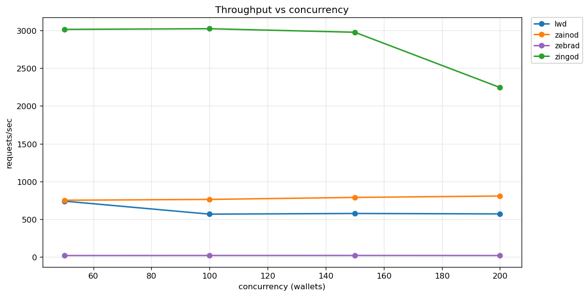

# cbb — Compact Block Bench

Realistic light-client load testing for Zcash CompactTxStreamer endpoints.

Compares **lightwalletd**, **zainod**, **zingod**, and **zebrad native** under wallet-style traffic.



## Dependencies

### Rust (the bench itself)
- Rust 1.70+ (stable)
- A running CompactTxStreamer endpoint (lightwalletd, zainod, zingod, or zebrad with lightwalletd_listen_addr)

```bash
cargo build --release
```

### Python (graphs + summary)
```bash
sudo apt install python3-matplotlib
```
(Only needed if you want to generate plots or run `summarize.py`.)

## Usage

```bash
# Compare four endpoints
./target/release/cbb \
  --endpoint lwd=http://127.0.0.1:9067 \
  --endpoint zainod=http://127.0.0.1:8137 \
  --endpoint zingod=http://127.0.0.1:9068 \
  --endpoint native=http://127.0.0.1:8237 \
  --concurrency 50 \
  --chunk 100 \
  --steps 20 \
  --start-height 2000000

# JSON output for graphing / summary
./target/release/cbb --json --endpoint lwd=http://127.0.0.1:9067 ...
```

### Flags

| Flag                  | Default | Description                                            |
| --------------------- | ------- | ------------------------------------------------------ |
| `--endpoint name=url` | —       | Repeatable. At least one required.                     |
| `--concurrency`       | 50      | Number of virtual wallets                              |
| `--chunk`             | 100     | Blocks per `GetBlockRange`                             |
| `--steps`             | 20      | Sequential range requests per wallet                   |
| `--start-height`      | 2000000 | Starting height (wallets are offset)                   |
| `--tree-every`        | 5       | Call `GetTreeState` every N range requests (0 = never) |
| `--timeout`           | 30      | Request timeout in seconds                             |
| `--warmup`            | 2       | Warm-up requests per wallet (not counted)              |
| `--json`              | false   | Emit JSON summary instead of text                      |

## What it measures

- `GetBlockRange` latency (full stream drain)
- Occasional `GetTreeState`
- Error rate and timeouts
- p50 / p95 / p99 / max
- Throughput (requests/sec)
- Per-method breakdown


## Bench scripts

The `bench-*.sh` scripts run a full concurrency sweep (50 / 100 / 150 / 200) for one endpoint, doing both a cold pass and a warm pass, and save JSON results under `results/`.

| Script                     | Endpoint                          | Notes                                      |
| -------------------------- | --------------------------------- | ------------------------------------------ |
| `bench-lwd.sh`             | `lwd=http://127.0.0.1:9067`       |                                            |
| `bench-zainod.sh`          | `zainod=http://127.0.0.1:8137`    |                                            |
| `bench-zingod.sh`          | `zingod=https://127.0.0.1:8137`   | Extracts TLS cert to `zingod-ca.pem` if needed |
| `bench-zebrad-native.sh`   | `zebrad=http://127.0.0.1:9069`    |                                            |

Each script:
- Uses `--steps 50`, `--chunk 100`, `--start-height 2000000`
- Prints human-readable output, then writes JSON to `results/<name>-<conc>-pass1.json` and `...-pass2-warm.json`
- Can be edited if your ports or parameters differ

```bash
# make sure the binary is built
cargo build --release

# run one indexer (adjust the script if the port differs)
./bench-lwd.sh
./bench-zainod.sh
./bench-zingod.sh
./bench-zebrad-native.sh
```

After they finish you can generate the summary and graphs:

```bash
python3 summarize.py
python3 graph.py
python3 cold-warm-bars.py
```

## Reading the results

### Summary table (`summarize.py`)

```bash
python3 summarize.py
```

Prints every `results/*.json` sorted by indexer then concurrency, plus a delta table vs the best result in each group.

- **Absolute table**: raw numbers (err%, p50/p95/p99 in ms, rps, wall time).
- **Delta table**: percent difference from the best value at the same concurrency + warm/cold.
  - Green = best (or tied)
  - Yellow = moderate regression
  - Red = large regression
  - Positive latency Δ% = slower than best
  - Negative rps Δ% = lower throughput than best


### Graphs (`graph.py` / `cold-warm-bars.py`)

```bash
python3 graph.py
python3 cold-warm-bars.py
```

Produces PNG files in `graphs/` (and `graphs/log/` for log-scale versions).

- Line plots (`graph.py`): metric vs concurrency for each indexer.
- Grouped bars (`cold-warm-bars.py`): cold (pass1) vs warm (pass2) side-by-side.
- Log-scale versions make large spreads (e.g. zebrad vs the others) readable.

Colors are consistent across all plots so you can track the same indexer easily.

## Community results

Please share your numbers! Different hardware, OS, Zebra versions, and network conditions produce different results.  

Open an issue or PR with:
- Your `results/*.json` files (or the `summarize.py` output)
- Hardware / OS / Zebra version
- Any endpoint-specific flags or config you used

The more data points we have, the clearer the picture becomes for light-client operators.

## Notes

- All endpoints should be pointed at the **same** underlying zebrad for a fair comparison.
- First run after indexer start is cold; re-run for warm-cache numbers.
- Increase `--concurrency` and `--steps` to stress resource limits.
- `target/` is gitignored — rebuild with `cargo build --release`.
