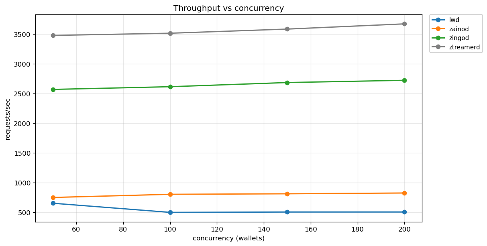
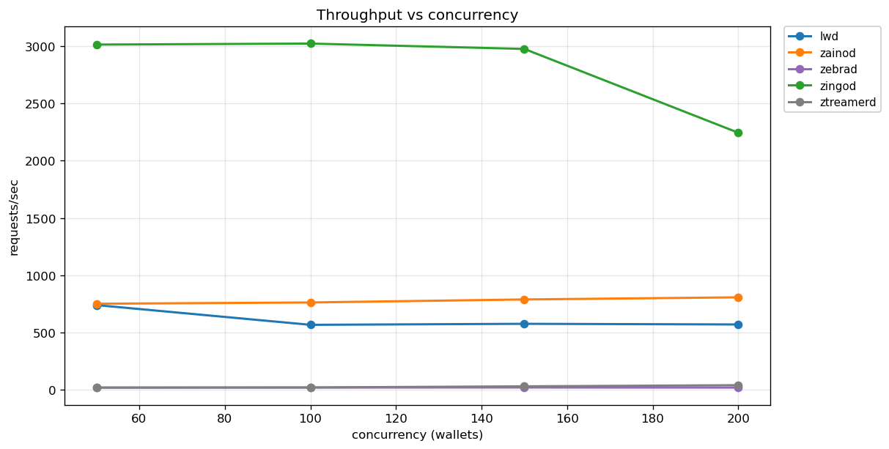

# cbb — Compact Block Bench

Realistic light-client load testing for Zcash CompactTxStreamer endpoints.

Compares **lightwalletd**, **zainod**, **zingod**, **zebrad native**, **ztreamerd**, and **zinder** under wallet-style traffic.


> **Note on throughput (req/s):**  
Throughput is `(total_requests - errors) / wall_time`: only successful requests count, across `GetBlockRange` and `GetTreeState`.
Wall time runs from the shared start line to the last wallet finishing, so connection setup and warm-up are excluded.
A fast method can raise the number even when another method is slow.  
For a pure block-serving comparison use `--tree-every 0` (the bench scripts' `--blockrange` option); for tree-state cost look at `GetTreeState` latencies.


### BlockRange only



### BlockRange + GetTreeState



## Dependencies

### Rust (the bench itself)
- Rust 1.70+ (stable)
- A running CompactTxStreamer endpoint (lightwalletd, zainod, zingod, zebrad with `lightwalletd_listen_addr`, ztreamerd, or zinder's `zinder-compat-lightwalletd`)

```bash
cargo build --release
```

### Python (graphs + summary)
```bash
sudo apt install python3-matplotlib
```
(Only needed if you want to generate plots or run `summarize.py`.)

## Usage

```bash
# Compare endpoints
./target/release/cbb \
  --endpoint lwd=http://127.0.0.1:9067 \
  --endpoint zainod=http://127.0.0.1:8137 \
  --endpoint zingod=http://127.0.0.1:9068 \
  --endpoint native=http://127.0.0.1:8237 \
  --endpoint ztreamerd=http://127.0.0.1:9067 \
  --endpoint zinder=http://127.0.0.1:9067 \
  --concurrency 50 \
  --chunk 100 \
  --steps 20 \
  --start-height 2000000

# JSON output for graphing / summary
./target/release/cbb --json --endpoint lwd=http://127.0.0.1:9067 ...
```

### Flags

| Flag                  | Default | Description                                            |
| --------------------- | ------- | ------------------------------------------------------ |
| `--endpoint name=url` | —       | Repeatable. At least one required.                     |
| `--concurrency`       | 50      | Number of virtual wallets                              |
| `--chunk`             | 100     | Blocks per `GetBlockRange`                             |
| `--steps`             | 20      | Measured range or tree-only requests per wallet                   |
| `--start-height`      | 2000000 | Starting height (wallets are offset)                   |
| `--tree-every`        | 5       | Call `GetTreeState` every N range requests (0 = never) |
| `--tree-heights-file PATH` | —   | Run only `GetTreeState` at heights from a file |
| `--timeout`           | 30      | Timeout in seconds per connection or request          |
| `--warmup`            | 2       | Warm-up requests per wallet (not counted)              |
| `--json`              | false   | Emit JSON summary instead of text                      |
| `--range-order asc\|desc` | asc | Direction of each `GetBlockRange`; both cover the same height intervals |
| `--expect-chain NAME` | —       | Before measuring, require `GetLightdInfo` to report this chain name |
| `--expect-tip HEIGHT:HASH_HEX` | — | Before measuring, require `GetLatestBlock` to report this tip |

For tree-only runs, list one distinct block height per line. Each endpoint uses
the same cyclic schedule, and warm-up repeats each wallet's first height.

### Run validation

CBB requires every configured wallet to connect and complete the expected
number of successful calls for each method. A wrong `GetTreeState` height,
an incomplete or out-of-order `GetBlockRange` stream, or a failed probe, task,
warm-up, or measured request makes the run fail. CBB writes the collected
reports before returning a nonzero exit status so failed runs can still be
inspected.

`--expect-chain` and `--expect-tip` check endpoint identity before wallet
connections and outside the measured window. The probe uses `--timeout`. A
failed check sets `probe_error`, skips that endpoint, and makes the command
exit nonzero. Specify the tip hash as 64 hex digits in the server's byte order.
For lightwalletd this is the reverse of the hash block explorers display.
Tree-only runs skip the probe unless either expectation is set.

### Range direction

`--range-order desc` requests each interval from its highest height down, so a
run covers the same heights as an ascending one. Every stream must arrive in
exactly the requested order with no missing or extra block, or the request
fails.

## What it measures

- `GetBlockRange` latency (full stream drain)
- `GetBlockRange` first-block latency, longest gap between blocks (streams of
  two or more blocks), delivered blocks, and blocks per second of wall time
  from successful streams. The range method's JSON reports `first_block`,
  `max_block_gap`, `blocks`, and `blocks_per_sec` when there are eligible samples.
- Occasional `GetTreeState`
- Error rate and timeouts
- p50 / p95 / p99 / max
- Throughput (successful requests/sec across the run and by method)
- Per-method breakdown

## Bench scripts

The `bench-*.sh` scripts run two passes per concurrency (50 / 100 / 150 / 200) for one endpoint and save JSON results under `results/`.

| Script                   | Endpoint                        | Notes                                          |
| ------------------------ | ------------------------------- | ---------------------------------------------- |
| `bench-lwd.sh`           | `lwd=http://127.0.0.1:9067`     |                                                |
| `bench-zainod.sh`        | `zainod=http://127.0.0.1:8137`  |                                                |
| `bench-zingod.sh`        | `zingod=http://127.0.0.1:8137`  | Needs `[grpc] max_connections_per_ip = 256`    |
| `bench-zebrad-native.sh` | `zebrad=http://127.0.0.1:9069`  |                                                |
| `bench-ztreamerd.sh`     | `ztreamerd=http://127.0.0.1:9067` |                                              |
| `bench-zinder.sh`        | `zinder=http://127.0.0.1:9067`  | Targets `zinder-compat-lightwalletd`; record its `[compat] serving` mode |

Each script accepts an optional mode flag:

| Flag           | Effect                                              | Output tag      |
| -------------- | --------------------------------------------------- | --------------- |
| *(none)*       | Default mixed workload (`GetBlockRange` + occasional `GetTreeState`) | *(none)*        |
| `--blockrange` | `GetBlockRange` only (`--tree-every 0`)             | `-blockrange`   |


Each script:
- Uses `--steps 50`, `--chunk 100`, `--start-height 2000000`
- Prints a human-readable summary and saves JSON from the same run to `results/`
- Runs every trial and exits nonzero if any trial fails
- Can be edited if your ports or parameters differ

```bash
# make sure the binary is built
cargo build --release

# default mixed workload
./bench-lwd.sh
./bench-zainod.sh
./bench-zingod.sh
./bench-zebrad-native.sh
./bench-ztreamerd.sh
./bench-zinder.sh

# GetBlockRange only
./bench-ztreamerd.sh --blockrange

# GetTreeState maximized
./bench-ztreamerd.sh --tree
```

### Result filenames

| Mode           | Example                                      |
| -------------- | -------------------------------------------- |
| Default        | `results/ztreamerd-50-pass2-warm.json`       |
| `--blockrange` | `results/ztreamerd-blockrange-50-pass2-warm.json` |

After they finish you can generate the summary and graphs:

```bash
python3 summarize.py
python3 graph.py
python3 cold-warm-bars.py
```

The graphing scripts understand all three filename styles and assign a distinct color to every indexer.

## Reading the results

Check the configured and connected wallet counts before comparing throughput.
RPC error counts cover measured calls, and latency covers successful calls.

### Summary table (`summarize.py`)

```bash
python3 summarize.py
```

Prints every `results/*.json` sorted by indexer then concurrency, plus a delta table vs the best result in each group.

- **Absolute table**: raw numbers (err%, p50/p95/p99 in ms, rps, wall time).
- **Delta table**: percent difference from the best value at the same concurrency, workload, and pass.
- Green = best (or tied)
- Yellow = moderate regression
- Red = large regression
- Positive latency Δ% = slower than best
- Negative rps Δ% = lower throughput than best


### Graphs (`graph.py` / `cold-warm-bars.py`)

```bash
python3 graph.py
python3 cold-warm-bars.py
```

Produces PNG files in `graphs/` (linear and `_log` versions).

- Line plots (`graph.py`): metric vs concurrency for each indexer.
- Grouped bars (`cold-warm-bars.py`): pass 1 and pass 2 side by side.
- Log-scale versions make large spreads readable.

Colors are consistent across all plots so you can track the same indexer easily. New indexers automatically receive a distinct color.

## Community results

Please share your numbers! Different hardware, OS, Zebra versions, and network conditions produce different results.

Open an issue or PR with:
- Your `results/*.json` files (or the `summarize.py` output)
- Hardware / OS / Zebra version
- Any endpoint-specific flags or config you used

The more data points we have, the clearer the picture becomes for light-client operators.

## Notes

- All endpoints should be pointed at the **same** underlying chain data for a fair comparison.
- Record how you prepare the server and OS caches for each pass.
- Increase `--concurrency` and `--steps` to stress resource limits.
- `target/` is gitignored — rebuild with `cargo build --release`.
- `GetTreeState` performance can vary significantly between indexers. Use `--blockrange` to isolate `GetBlockRange` throughput.
